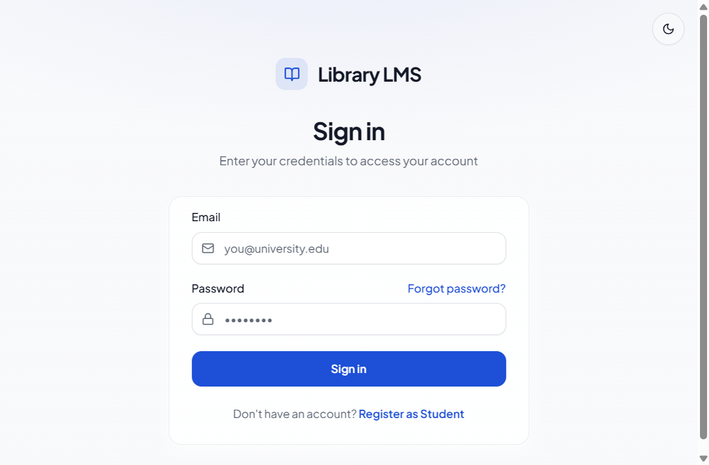
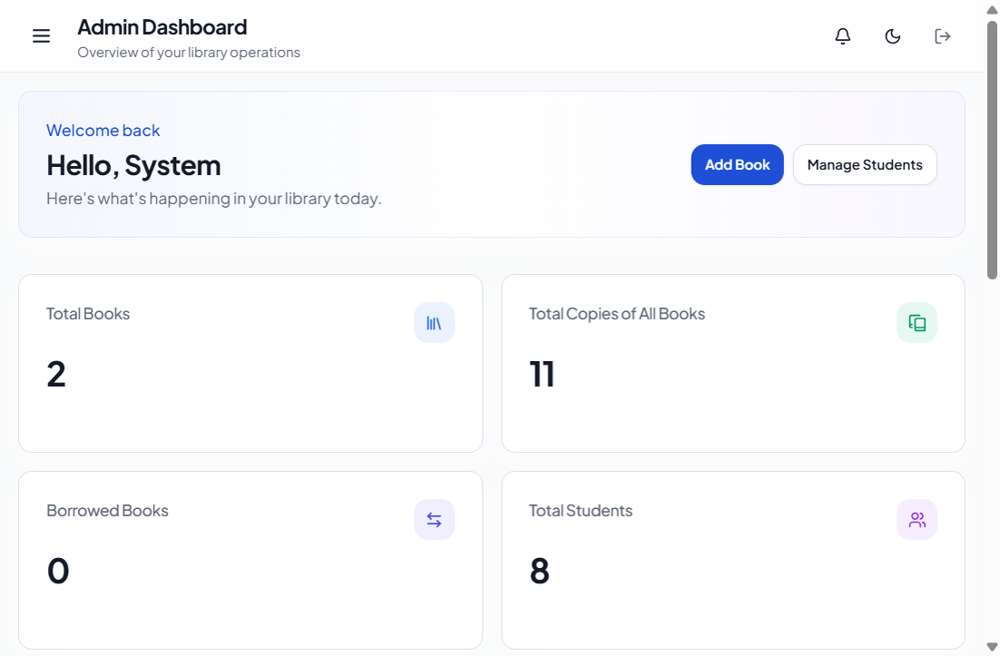
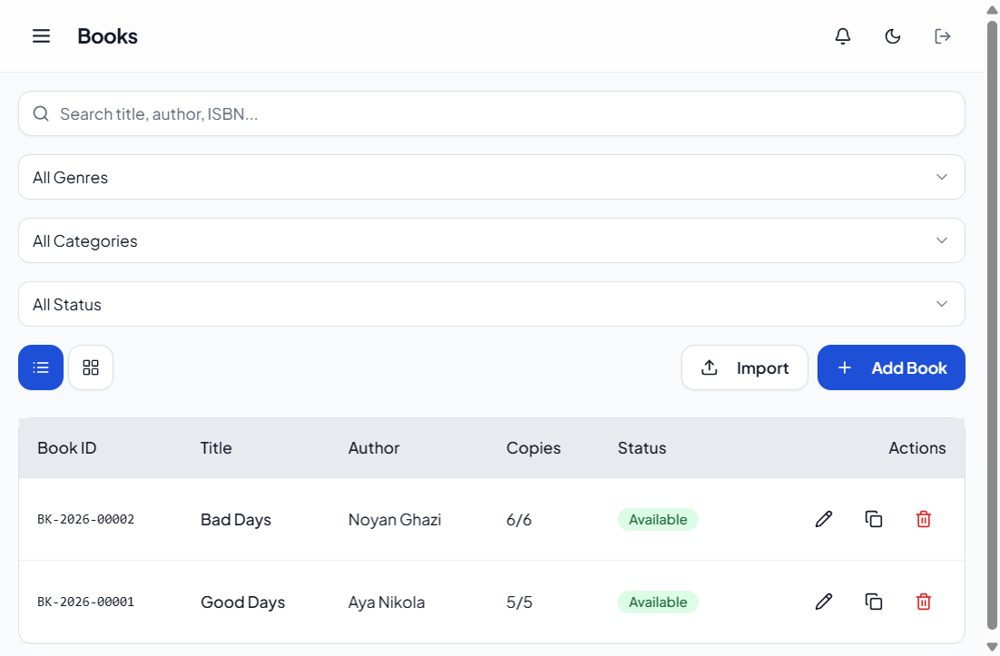
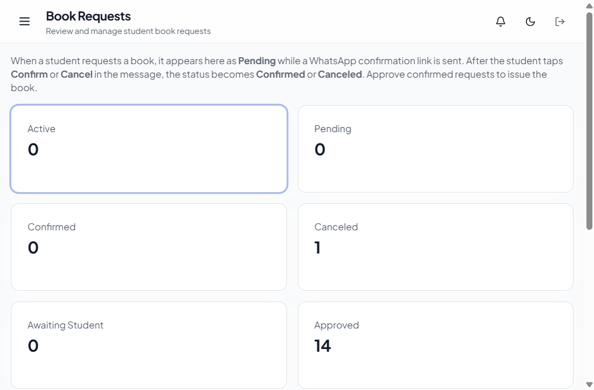
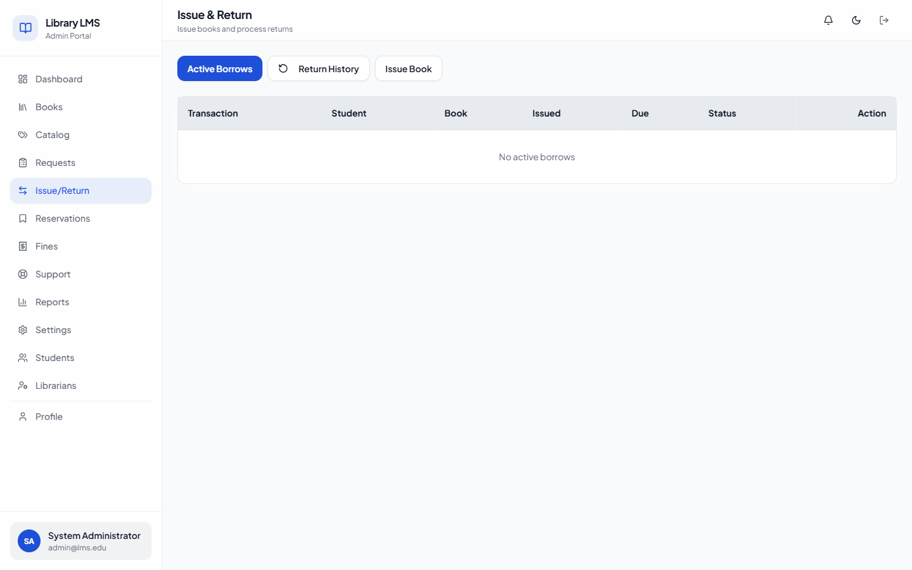
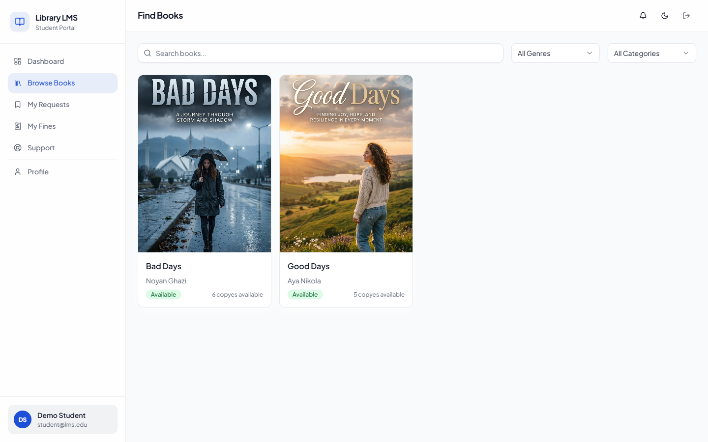
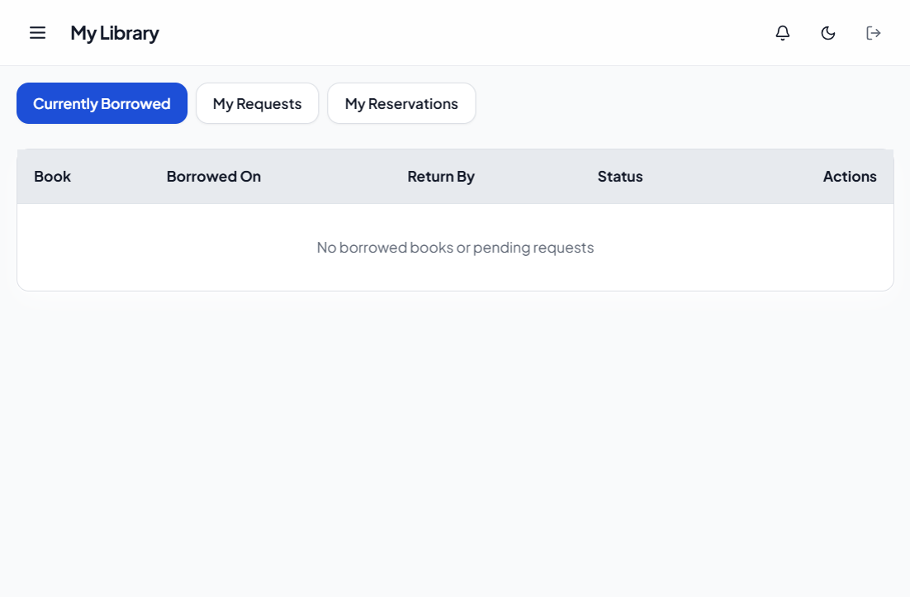

# Library Management System (LMS)

A complete Library Management System for educational institutions, built with the MERN stack (MongoDB, Express, React, Node.js).  
Includes **Admin**, **Librarian**, and **Student** roles with Role-Based Access Control (RBAC).

## Features

- Admin panel with full system control
- Librarian portal for day-to-day library operations
- Student portal to browse, request, and track books
- Role-Based Access Control (RBAC) with fine-grained permissions
- Book catalog (genres, categories, covers, bulk import)
- Book request workflow with WhatsApp confirmation
- Issue / return desk and overdue tracking
- Reservations with expiry
- Fines, payments, and configurable auto-block rules
- Support tickets with timeline
- Role-based dashboards, notifications, and PDF/Excel reports
- Clean, responsive UI (React + Tailwind + ShadCN)
- Secure authentication (JWT + refresh tokens)

## User Roles & Flow

| Role | Access |
|------|--------|
| **Admin** | Full control — users, settings, reports, catalog, borrow desk, fines, support |
| **Librarian** | Operations — books, requests, issue/return, fines, support, reports (no system settings / librarian CRUD) |
| **Student** | Self-service — browse books, request/reserve, view own borrows & fines, open support tickets |

**Typical flow**

1. Student browses the catalog and requests a book  
2. Student confirms via WhatsApp (or web confirmation link)  
3. Librarian/Admin reviews and approves the confirmed request  
4. Book is issued; due dates, reminders, and fines are tracked automatically  

## Tech Stack

- **Frontend:** React 18, TypeScript, Vite, Tailwind CSS, ShadCN/Radix UI, React Query, React Router
- **Backend:** Node.js, Express.js, TypeScript, Mongoose
- **Database:** MongoDB
- **Authentication:** JWT access tokens + httpOnly refresh cookies, bcrypt, RBAC
- **Integrations:** WhatsApp (WasenderApi / Meta / Twilio), Nodemailer, Cloudinary
- **Reports:** PDFKit, ExcelJS

## Screenshots

### Login



### Admin Dashboard



### Book Inventory



### Book Requests



### Issue & Return



### Student — Browse Books



### Student — My Library



## Installation

### Prerequisites

- Node.js 20+
- MongoDB (local or Docker)

### Steps

1. Clone the repository
2. Start MongoDB (Docker example):
   ```bash
   docker compose -f docker-compose.dev.yml up -d
   ```
3. Install dependencies:
   ```bash
   npm install
   npm install --prefix backend
   npm install --prefix frontend
   ```
4. Configure the backend environment:
   ```bash
   cp backend/.env.example backend/.env
   ```
5. Seed demo data and users:
   ```bash
   npm run seed
   ```
6. Start the app (backend + frontend):
   ```bash
   npm run dev
   ```
7. Open **http://localhost:5173**

Backend API runs at `http://localhost:5000/api/v1`.

## Default Demo Accounts

| Role | Email | Password |
|------|-------|----------|
| Admin | `admin@lms.edu` | `Admin@123456` |
| Librarian | `librarian@lms.edu` | `Librarian@123456` |
| Student | `student@lms.edu` | `Student@123456` |

Change these credentials in any shared or production environment.

## More Documentation

- [Development & WhatsApp setup](docs/DEVELOPMENT.md)
- [Wasender button messages](docs/WHATSAPP-BUTTONS.md)

## Author

**Zarak-Ahmad**  
Full-Stack Developer (Laravel + MERN)

## License

MIT
